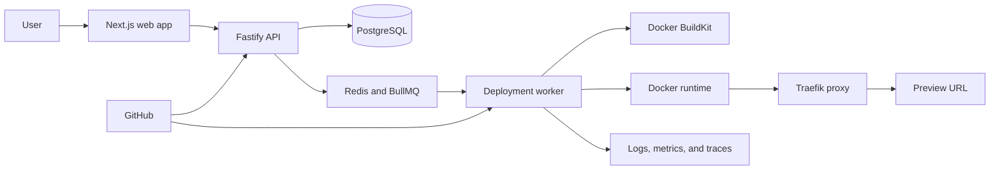

# LaunchRail

**A self-hosted platform that turns a GitHub repository into a health-checked application deployment with live logs, preview URLs, release history, and safe rollback.**

> **Phases 0–9 are Available; Phases 10–16 are undergoing release acceptance.** The core public-GitHub deployment pipeline has been exercised against real PostgreSQL, Redis, BuildKit, Docker, and Traefik. Verification fixed atomic deployment creation, immutable runtime settings, non-root image permissions, startup readiness, source cleanup, and loopback routing. Durable rollback now recreates missing prior containers and rejects unhealthy targets while retaining the current release. Broad interruption recovery, complete accessible onboarding, controlled benchmark results, and final release evidence remain; this is a single-host demonstration, not a production hosting service.

Exact-revision rollback and cleanup proof is retained in the [acceptance evidence](docs/acceptance-evidence.md), including unedited missing-container and unhealthy-container reports.

Current release verification also exercises real request-to-worker trace correlation and success/failure outcome metrics. A dedicated collector checks secret boundaries and export failure; bounded telemetry dropping does not discard deployment work. Dashboard review and the remaining whole-release gates are still open.

## What LaunchRail does

LaunchRail can build a public GitHub revision, run it in a restricted container, gate activation on an HTTP health check, and expose a local preview URL. Deployment creation is available through the project workspace for exact commit SHAs or through a configured signed push webhook.

The finished local demonstration will let a user:

- Connect a GitHub repository and select a revision to deploy.
- Inspect retained build output and recent runtime logs from the project timeline.
- Open a generated preview URL after health checks pass.
- Inspect deployment history and actionable failure details.
- Retry, cancel, stop, or roll back a release.
- Trigger deployments from verified GitHub push webhooks.

The engineering challenge goes beyond starting a container: LaunchRail must coordinate long-running jobs, preserve the last healthy release when a new one fails, recover safely after worker restarts, isolate organizations, and expose enough telemetry to explain what happened.

## How it fits together



LaunchRail will use a modular monolith for the web/API boundary and a separate worker for deployment jobs. Infrastructure-specific behavior sits behind explicit interfaces so the core deployment rules do not depend directly on Docker, GitHub, Redis, or the web framework. See [ARCHITECTURE.md](ARCHITECTURE.md) for the technical design.

## Current status

### Available

- Product scope, target users, success criteria, and non-goals.
- Proposed architecture and initial technology decisions.
- Deployment lifecycle and explicit state-machine design.
- Initial threat model, security boundaries, and phased roadmap.
- Pinned pnpm workspace with Next.js web, Fastify API, worker, and shared packages.
- Health endpoints for all three applications and structured API/worker logging.
- Validated environment configuration with actionable errors and production guards.
- Loopback-only PostgreSQL and Redis development services with health checks.
- Formatting, linting, type checking, unit/integration tests, builds, smoke tests, and GitHub Actions.
- Apache 2.0 open-source license.
- Organization-scoped users, memberships, projects, deployments, events, logs, runtime instances, encrypted-variable metadata, webhook deliveries, and audit events.
- Generated Drizzle migrations plus an immutable deployment snapshot guard.
- Central fourteen-state deployment lifecycle with exhaustive valid/invalid transition tests.
- Transactional, idempotent PostgreSQL transitions that append ordered events and audit records.
- Health-gated promotion that atomically supersedes the previous release and maintains one active pointer.
- Scrypt password credentials and bootstrapped first-owner setup without logged secrets.
- Hashed opaque sessions with absolute/idle expiry, rolling activity, and revocation.
- Owner, admin, developer, and viewer permission policies enforced at organization API boundaries.
- Cross-organization concealment, strict origin checks, sign-in throttling, secure cookie policy, and security headers.
- Organization member management, audit-history APIs, and a responsive sign-in/session surface.
- Real-PostgreSQL authorization coverage for every role and protected cross-organization path.
- Organization-scoped project create, read, update, and soft-archive APIs with optimistic versions and audited writes.
- Canonical `https://github.com/owner/repository` input plus safe branch, Dockerfile, health-check, and bounded runtime configuration.
- AES-256-GCM environment-variable storage with fresh nonces, authentication tags, a versioned keyring, and organization/project/name-bound authenticated context.
- Write-only secret values: owner/admin users receive names and timestamps, while plaintext is never returned by project APIs.
- Responsive `/projects` workspace with role-aware create, edit, archive, and environment-variable controls.
- Strict `deployment.claim` and `deployment.prepare_source` wake-ups carrying only a contract version, supported kind, and opaque PostgreSQL work-item ID.
- Durable PostgreSQL attempts, due times, leases, fencing, dead-letter state, and operational worker heartbeats are implemented.
- The worker uses at-least-once BullMQ wake-ups, PostgreSQL-managed retry/reconciliation, and lease-fenced transactions for both the `queued` to `cloning` claim and `cloning` to `building` source handoff.
- Fixed-origin, public-only GitHub resolution verifies repository visibility, requested revision, exact commit/tree identity, and bounded tree metadata without redirects or ambient credentials.
- Hardened Git checkout uses no shell, isolates configuration and credentials, fetches the verified SHA, bounds time/output/disk use, and cancels the complete process group.
- Post-checkout inspection verifies Git blob identities, enforces file/byte/path/depth limits, rejects unsupported files/LFS/unsafe symlinks, and stores a contained Dockerfile path and digest.
- Immutable portable source-preparation metadata and revalidated checkout adoption make duplicate delivery and worker restart safe without storing absolute host paths.
- Clean disposable PostgreSQL/Redis acceptance, source fixtures, code-quality, build, and health checks are verified by [GitHub Actions run 31414001234](https://github.com/Zamuel66666/LaunchRail/actions/runs/31414001234).
- Restricted Docker runtimes use stable ownership labels, loopback-only dynamic ports, a non-root user, dropped Linux capabilities, no-new-privileges, resource limits, optional read-only root filesystems, bounded timestamped log reads, and idempotent adoption/removal.
- Clean PostgreSQL/Redis recovery plus real constrained BuildKit and Docker lifecycle acceptance are verified by [GitHub Actions run 34690600740](https://github.com/Zamuel66666/LaunchRail/actions/runs/34690600740).
- Pinned Traefik file-provider routing uses collision-resistant deployment hostnames, atomic private configuration files, bounded targets, and observed-state reconciliation; real proxy acceptance is verified by [GitHub Actions run 34769727393](https://github.com/Zamuel66666/LaunchRail/actions/runs/34769727393).
- Runtime startup can gate completion on bounded loopback-only HTTP health checks, configurable grace periods, durable history, and worker-driven idempotent activation.
- Authenticated deployment controls expose bounded health/event history, retry lineage, promote, cancel, stop, and rollback operations. The project timeline has confirmations and client-safe conflict feedback for release-changing actions.
- Verified GitHub push webhooks are signature-checked, deduplicated, filtered to configured project branches, create immutable queued deployment snapshots, and immediately publish durable claim wake-ups; reconciliation remains the safe fallback if Redis is unavailable.
- API request counters and correlation IDs plus worker process metrics are available at Prometheus-compatible metrics endpoints.
- API database and worker database/Redis readiness are exposed separately from process liveness and instrumented with bounded metrics; optional W3C traces can be exported to a configured OTLP/HTTP collector.
- Persistence-adapter spans correlate API/worker database operations without exporting SQL text, bind parameters, record IDs, or user data.
- The project workspace shows each deployment's recorded health attempts and ordered lifecycle activity, and confirms stop/cancel/rollback actions before sending them.
- Runtime health failures are categorized and recorded before terminal failure, preserve the previous active release and preview route, and interrupted startup grace cleans the candidate runtime without probing or promoting it.
- Owner/admin users can expand deployment-scoped audit entries alongside lifecycle events.
- Signed webhook outcomes are persisted, reviewable by audit readers, and failed verified deliveries can be retried without duplicating a deployment for the same delivery/project pair.
- The API and worker expose route, webhook, queue, durable stage-outcome, build-cache, runtime/route-duration, heartbeat-age, and health metrics; an optional loopback-only Prometheus/Grafana overlay provisions the LaunchRail Operations dashboard.
- Worker retry/timeout, build/cleanup, health-grace, orphan inventory, route-repair, and deployment-outcome telemetry is available with starter local alert rules.
- Deployment controllers can start a project deployment from a full exact Git commit SHA; durable work is persisted before the best-effort queue wake-up.
- Organization readers can open bounded, retained build output from each deployment in the project timeline.
- Worker reconciliation inventories LaunchRail-labeled containers, protects live leased runtimes, and cleans unrecorded or terminal runtime containers with persisted cleanup outcomes.
- `pnpm benchmark:api` emits a reproducible loopback API liveness JSON report; `docs/release-checklist.md` records the public release gates.
- `pnpm benchmark:deployment` can run up to ten sequential, explicitly opted-in exact-SHA attempts and report event-derived stage durations and host metadata without saving results automatically.
- The landing page links to a guided `/demo` walkthrough; confirmations can be dismissed with Escape, and reduced-motion preferences are honored.
- The `/demo` walkthrough includes a first-run checklist and explicit safety boundaries; every web screen has a keyboard skip-to-main-content link.

### Planned next

- Complete and independently verify all recovery boundaries, operator-control races, trace-export redaction/collector behavior, accessible first-run onboarding, broader controlled benchmarks, and release evidence.

### Not currently planned

- Kubernetes, multi-region deployment, billing, enterprise SSO, and public multi-tenant hosting.
- A custom container runtime, mobile apps, or AI deployment recommendations.

## Try it locally

Prerequisites: Node.js 22.22 or newer, Corepack/pnpm 11.9, Docker, and Docker Compose.

```bash
corepack enable
pnpm install --frozen-lockfile
pnpm setup:local
pnpm db:migrate
# Set the LAUNCHRAIL_BOOTSTRAP_* values in .env, then run:
pnpm auth:bootstrap
pnpm dev
```

Never commit `.env` or the generated key. Open [http://localhost:3000/projects](http://localhost:3000/projects) for project management or [http://localhost:3000](http://localhost:3000) for the recruiter-readable overview. Health endpoints are available at:

- Web: `http://localhost:3000/api/health`
- API: `http://localhost:4000/health`
- Worker: `http://localhost:4001/health`

Stop the application processes with `Ctrl+C`, then stop PostgreSQL and Redis without deleting their volumes:

```bash
pnpm services:down
```

See the [development guide](docs/development.md) for verification, configuration, cleanup, and troubleshooting.

The [single-host operations guide](docs/operations.md) covers private PostgreSQL backups, non-destructive restore rehearsals, service interruptions, and recovery ownership. Do not run workers backed by different databases against the same Docker host.

## Documentation

- [Product scope](docs/product-scope.md)
- The running web app includes a guided `/demo` walkthrough.
- [Architecture](ARCHITECTURE.md)
- [Deployment lifecycle](docs/deployment-lifecycle.md)
- [Security policy](SECURITY.md) and [threat model](docs/threat-model.md)
- [Roadmap](ROADMAP.md) and [changelog](CHANGELOG.md)
- [Contributing](CONTRIBUTING.md) and [development workflow](docs/development.md)
- [Testing strategy](docs/testing.md), [observability and dashboard setup](docs/observability.md), and [benchmark methodology](docs/benchmarks.md)
- [Persistence model and transaction rules](docs/persistence.md)
- [Authentication and authorization](docs/authentication.md)
- [Project management and secret rotation](docs/project-management.md)
- [Queue and worker operations](docs/queue-worker.md)
- [GitHub webhook delivery operations](docs/webhooks.md)
- [Repository preparation and source security](docs/repository-preparation.md)
- [Image builds and BuildKit boundaries](docs/image-builds.md)
- [Observability and local dashboard setup](docs/observability.md)
- [Benchmark methodology and API baseline](docs/benchmarks.md)
- [Public release checklist](docs/release-checklist.md)
- [Architecture decisions](docs/adr/)

## Current limitations

LaunchRail is not production-ready. Authentication remains local-password only without password reset, invitations, MFA, SSO, or session administration. Source preparation supports unauthenticated public GitHub repositories only; private repositories, Git LFS, submodules, and external-network acceptance smoke tests are unsupported. Runtime-container orphan cleanup, active-runtime loss detection, terminal source-checkout cleanup, 24-hour stale source/build staging cleanup, and lease/record-aware orphan BuildKit image cleanup are implemented; worker readiness probes Docker and bootstraps the configured Buildx node, but restarting a lost Docker daemon and broad interruption recovery remain incomplete. Saved secrets are not placed in Redis or injected into workloads, and automated key re-encryption is not implemented. The browser exposes bounded retained build output and an on-demand tail of runtime output when the shared API/worker credential is configured; runtime output is application-controlled and can contain sensitive data. Registry publication/signing/scanning, remote metrics aggregation, and individual SQL-statement tracing remain unfinished. W3C request/queue trace export is available when `OTEL_EXPORTER_OTLP_ENDPOINT` is configured, but awaits independent verification. The BuildKit daemon and Docker host are trusted infrastructure, so current limits do not make a single-host worker a hostile multi-tenant sandbox. `/health` and `pnpm smoke:health` prove process liveness only; `/ready` probes API PostgreSQL and worker PostgreSQL/Redis, and Docker/BuildKit on workers, but not queue depth or proxy health. Manual deployment creation requires an exact full commit SHA from a public GitHub repository. Recent Phases 10–16 implementation changes are awaiting independent verification; no benchmark result has been published and no release is ready.

## License

LaunchRail is licensed under the [Apache License 2.0](LICENSE). See [ADR-0005](docs/adr/0005-apache-2-license.md) for the decision.
